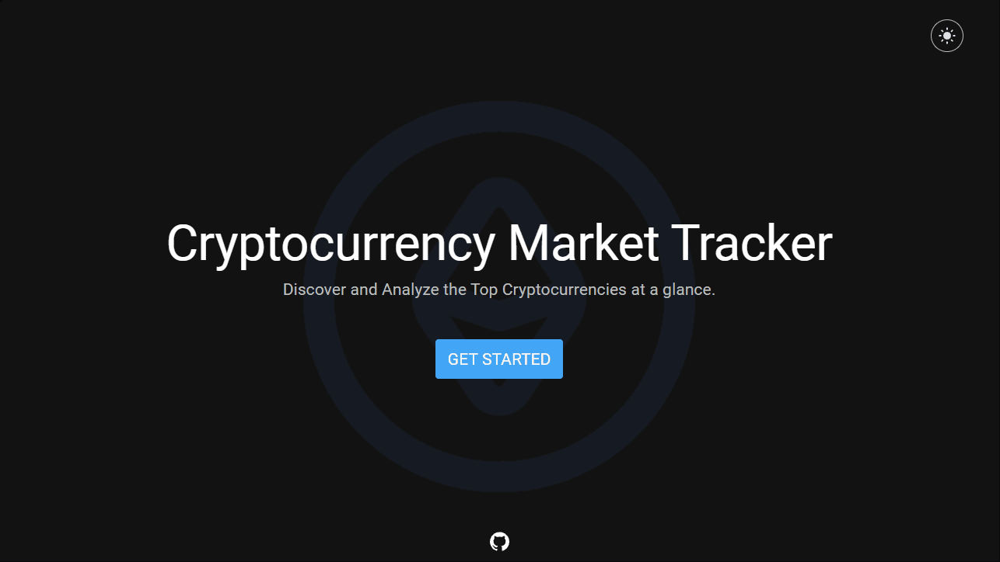
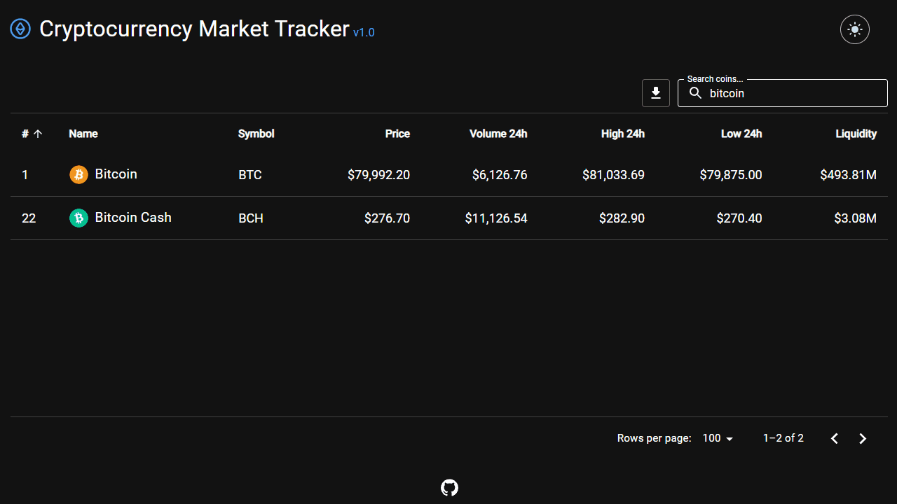

# 🪙 Cryptocurrency Market Tracker

**A full-stack, Dockerized crypto market tracker with an automated ETL pipeline, technical analysis and LSTM price predictions, deployed to production with CI/CD.**

🌐 **Live demo:** [crypto-market-tracker.duckdns.org](https://crypto-market-tracker.duckdns.org)

<p align="left">
  
  
  
  
  
  
  
  <br>
  
  
  
  
  
</p>

<p align="center">
  
  <br>
  <em>Market overview: browse 380+ coins, page through the table and search instantly</em>
</p>

## 📌 About this project

The app displays live market data, historical OHLCV charts, technical-analysis indicators and LSTM-based price predictions. A Spring Boot backend exposes a REST API for the frontend and runs an ETL pipeline that extracts data from external market APIs, transforms it and loads it into MongoDB every 30 minutes. The frontend refetches the data periodically, so changes written by the pipeline appear in the interface automatically.

## ✨ Features

- 📊 Live market data for 380+ cryptocurrencies, with search and pagination
- 📈 Historical OHLCV charts with 1D, 1W, 1M, 6M, 1Y and YTD timeframes
- 🧮 Technical-analysis indicators: SMA, EMA, WMA, Bollinger Bands, volume analysis, RSI, MACD and the Stochastic Oscillator, each with a bullish/bearish/neutral signal
- 🤖 LSTM-based price predictions
- 🔄 Automated ETL pipeline that refreshes the database every 30 minutes
- ⏱️ Frontend auto-refresh every 10 minutes, so new data appears without reloading the page

<p align="center">
  
  <br>
  <em>Coin analysis: 24h data, OHLCV chart with selectable timeframes, and technical-analysis indicators</em>
</p>

## 👥 Team & my role

Built by a team of three as a faculty project. <!-- TODO: add the course name, e.g. "for the Design and Software Architecture course at FCSE" -->

- **Me ([@TaseZmaj](https://github.com/TaseZmaj)):** designed and built the entire React frontend, developed ~90% of the Spring Boot ETL pipeline, integrated the frontend with the backend, built the CI/CD pipeline, and handled containerization and production deployment
- **Teammates:** built the Python technical-analysis and LSTM microservices, integrated them with the backend, and wrote the project documentation

## 🧰 Tech stack

| Layer          | Technologies                                                                       |
| -------------- | ---------------------------------------------------------------------------------- |
| Frontend       | React, Vite, Material UI, ApexCharts, Nginx                                        |
| Backend        | Java 21, Spring Boot, REST API, scheduled ETL pipeline                             |
| Microservices  | Python, FastAPI, TensorFlow (LSTM)                                                 |
| Database       | MongoDB Atlas                                                                      |
| Infrastructure | Docker, Docker Compose, Docker Hub, GitHub Actions, Oracle Cloud VM, Caddy (HTTPS) |

## 🏛️ Architecture

The application is a Dockerized microservices system. Each service has its own Docker image and communicates with the others over the Docker network.

### 💻 Frontend

The frontend is a React and Vite application that uses Material UI for the interface and ApexCharts for market visualizations. It manages shared coin state through React contexts, requests data from the backend, and filters chart data by date range in the browser. It refreshes coin data every 10 minutes, so changes written by the ETL pipeline become visible without a full page reload. In production, the compiled Vite application is served by Nginx.

### ⚙️ Backend

The backend is a Java 21 Spring Boot service with two responsibilities: it is the application's REST API, and it owns the market-data pipeline.

#### 🔄 Data pipeline

The pipeline runs once when the backend starts and then every 30 minutes. It performs an ETL process:

1. **Extract:** retrieves cryptocurrency symbols, market summaries and historical OHLCV data from external market APIs.
2. **Transform:** validates the responses, maps external API models to the application's domain models, normalizes values, filters out delisted assets and prepares the data for persistence.
3. **Load:** stores symbols, summaries and historical data in MongoDB, so the data can be reused by the frontend and the supporting services.

The pipeline uses a lock to prevent overlapping executions. If a previous run is still processing data, the next scheduled run is skipped instead of running concurrently against the same database.

#### 🌐 REST API and service orchestration

Besides running the ETL pipeline, the backend is the central REST API for the frontend. It connects the application to the technical-analysis and LSTM microservices, sends them the requested coin and timeframe, and returns their results through its own API responses. The frontend therefore talks to a single backend entry point instead of coordinating the internal microservices directly.

The backend also serves persisted market data and historical chart data from MongoDB. This gives the system a clear flow: the pipeline updates the database, the backend coordinates the specialized analysis services, and the frontend receives a unified response with everything it needs to render the page.

### 🧮 Technical-analysis service

The technical-analysis service is a Python FastAPI microservice running on port `8082`. When the backend requests an analysis, it sends the selected coin and timeframe. The service reads the coin's historical OHLCV data from MongoDB, calculates technical-analysis indicators over it, and returns the results to the backend, which passes them to the frontend. <!-- TODO: name the indicators it calculates, e.g. RSI, MACD, moving averages, and whether it returns buy/sell signals -->

The service is internal: it isn't exposed to the internet and can only be reached by the backend over the private Docker network.

### 🤖 LSTM predictor service

The LSTM predictor is a Python FastAPI microservice running on port `8081` that uses TensorFlow to forecast future prices with an LSTM (Long Short-Term Memory) neural network. When the backend requests a prediction for a coin, the service loads the coin's historical price data from MongoDB, runs it through the model, and returns the predicted prices to the backend. <!-- TODO: describe how the model is trained (on startup, per request, or pre-trained) and what it predicts (e.g. the next N days' closing prices) -->

Like the technical-analysis service, it's reachable only through the backend over the private Docker network. Because loading the model is the most memory-intensive step in the system, its TensorFlow, OpenMP and MKL thread counts are limited (see [Memory optimization](#-memory-optimization)).

## 🏗️ Production infrastructure

### 🚢 CI/CD flow

When code is pushed to `main` or `master`, the CI workflow builds the four application images independently: backend, frontend, LSTM predictor and technical analysis. Each image is tagged with the commit SHA and published to Docker Hub, which gives every deployment an immutable, reproducible image version.

The CD workflow then connects to the Oracle VM, supplies the selected image tag and production environment values, pulls the matching images and runs the production Compose configuration. Docker Compose recreates only the changed application containers, while the external Atlas database stays persistent and Caddy keeps serving HTTPS as the internal services restart. The workflow can run a health check against the public API before marking the deployment successful.

This separation lets CI verify and publish artifacts independently of CD, and production always deploys a known image tag instead of rebuilding source code on the server.

### ☁️ Oracle Cloud Infrastructure

Production runs on an Oracle Cloud VM using Docker Compose, Docker Hub images, MongoDB Atlas and Caddy. The VM hosts the application containers, while Atlas remains an externally managed database. An x86/AMD VM is used because the published images and machine-learning dependencies are built for that architecture.

The public DNS record points the application hostname to the VM's public IP. Caddy is the only container that publishes host ports: TCP `80` handles HTTP and ACME certificate challenges, TCP `443` handles HTTPS, and UDP `443` can handle HTTP/3. Caddy terminates TLS and forwards browser requests to the private Nginx frontend container.

Nginx serves the compiled frontend and proxies `/api/` requests to the Spring Boot backend. The backend communicates with the technical-analysis and LSTM containers over the private Docker network, and those services are not directly reachable from the internet. Backend ETL requests go out to external market APIs, and database traffic goes out from the VM to MongoDB Atlas. Atlas credentials are injected through environment variables and are never stored in images or committed files.

### 🚀 Production request flow

```
Browser
  │ HTTPS :443
  ▼
Caddy (only public entry point, terminates TLS)
  │
  ▼
Nginx frontend :80
  │ /api/
  ▼
Spring Boot backend :8080 ──────► External market APIs (ETL)
  │
  ├──► Technical analysis :8082 ──┐
  ├──► LSTM predictor :8081 ──────┤
  │                               ▼
  └─────────────────────────► MongoDB Atlas
```

Only Caddy is exposed publicly. The frontend, backend and Python services communicate over the private Docker network, and MongoDB Atlas is reached through outbound database connections.

## 🛠️ Local development

### 📋 Requirements

- Docker Desktop with Docker Compose
- Git
- Node.js 20.19+ or Node.js 22.12+ for frontend tooling
- Java 21 and Maven (only if running the backend outside Docker)

### 🐳 Docker Compose configurations

There are two Docker Compose configurations for local development and testing:

- `docker-compose-dev.yml`: Vite development server with Docker Compose Watch
- `docker-compose.yml`: production-like frontend container served by Nginx, still using locally built images and a local MongoDB

### ⚡ Recommended local development workflow

1. Clone the repository and open a terminal in the repository root.
2. Start Docker Desktop.
3. Edit `.env.local` if you want to override the default local MongoDB URI:

   ```
   MONGODB_URI=mongodb://mongodb:27017/crypto_db
   MONGODB_DATABASE=crypto_db
   ```

4. There are 2 ways to start the Docker composition. For the **production-like** setup, use:

   ```
   docker compose --env-file .env.local -f docker-compose.yml up --build
   ```

   Or, to see frontend and backend code changes reflected instantly inside the composition, use this instead. It's best suited for **development**:

   ```
   docker compose --env-file .env.local -f docker-compose-dev.yml watch
   ```

5. Open the frontend at [http://localhost:3000](http://localhost:3000).
6. The local service endpoints are:
   - Backend: [http://localhost:8080](http://localhost:8080)
   - LSTM predictor: [http://localhost:8081](http://localhost:8081)
   - Technical analysis: [http://localhost:8082](http://localhost:8082)
   - MongoDB: `mongodb://localhost:27017/crypto_db`

7. Stop the stack with:

   ```
   docker compose -f docker-compose-dev.yml down
   ```

8. To stop the stack and delete the local MongoDB data volume (only when you intend to reset the database), use:

   ```
   docker compose -f docker-compose-dev.yml down -v
   ```

## 🧠 Memory optimization

The local and production-like Compose files include conservative settings for the Oracle Cloud free-tier VM:

- Java heap: `-Xms64m -Xmx256m -XX:+UseG1GC`
- TensorFlow intra-op and inter-op threads limited to `1`
- OpenMP and MKL threads limited to `1`
- `MALLOC_ARENA_MAX=2` for the Python services
- Local MongoDB WiredTiger cache limited to `0.25 GB`

These settings reduce peak memory usage without a hard Docker memory cap that could terminate the LSTM service while it loads its model.

## 📄 Project documentation

The repository also contains the project and requirements documentation:

- [Short project description](documentation/KratokOpis.pdf)
- [Software requirements specification](documentation/SrsDocumentation.pdf)

## 📂 Project structure

```
.
├── backend/                              Spring Boot REST API
├── frontend/                             React/Vite application
├── microservices/
│   ├── ltsm-predictor-service/           LSTM FastAPI service
│   └── technical-analysis-service/       Technical-analysis FastAPI service
├── caddy/                                Production HTTPS configuration
├── designs/                              UI designs
├── documentation/                        Project and SRS PDFs
├── demos/                                README demo GIFs
├── docker-compose-dev.yml                Development Compose stack
├── docker-compose.yml                    Local production-like stack
├── docker-compose.prod.yml               OCI production stack
└── .github/workflows/
    ├── ci-images.yml                     Build and publish images
    └── cd-oracle.yml                     Deploy to Oracle Cloud
```
